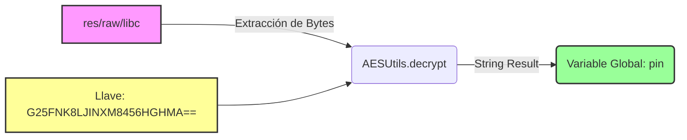

# 🔬 Reporte de Ingeniería Inversa: Hardware PIN Locker "com.cute.pin"

**Analista:** Sylvio Andrés Burgos (misteorecandy)  
**Categoría:** Análisis de Malware Móvil / Ransomware de Bloqueo de Hardware  
**Ecosistema:** Android OS (API 14 a API 21)  
**Técnicas Detectadas:** Abuso de la API DeviceAdmin, Criptografía Inversa, Hardcoded AES Keys  

---

## 📌 1. Resumen Ejecutivo

El espécimen analizado bajo el paquete raíz `com.cute.pin` representa una variante agresiva de malware móvil clasificada como **Hardware PIN Locker (secuestrador de contraseñas del sistema)**. 

A diferencia de las amenazas visuales basadas en ventanas flotantes persistentes, este troyano abusa legítimamente de la API de administración de dispositivos de Android para **sobrescribir de forma programática las credenciales de seguridad físicas del terminal**. El análisis forense estático revela el uso de técnicas de evasión mediante recursos binarios ofuscados (`raw/libc`) y el descifrado simétrico de la contraseña en tiempo de ejecución utilizando llaves criptográficas fijas en el código (*Hardcoded Cryptographic Keys*).

---

## ⚙️ 2. Análisis del Receptor de Administración (`Pin.java`)

El componente `Pin` hereda de la clase oficial `DeviceAdminReceiver`, actuando como el brazo ejecutor de las políticas restrictivas del sistema una vez que el usuario concede los privilegios elevados por ingeniería social.

### A. Secuestro Inmediato en la Activación
En el instante en que el evento `DEVICE_ADMIN_ENABLED` es aprobado, el método `onEnabled()` sobreescribe el PIN de seguridad del dispositivo mediante la API nativa de administración de políticas:

```java
getManager(context).resetPassword(MainActivity.pin, 0);
```

### B. Lógica Anti-Desactivación Automatizada (Persistencia Defensiva)
Para contrarrestar los intentos del usuario de revocar los privilegios desde los ajustes del sistema, el malware implementa un bucle defensivo interceptando el método `onDisableRequested()`:

* **`getManager(context).lockNow();`** -> Envía una señal inmediata para suspender el hardware y bloquear la pantalla.
* **`getManager(context).resetPassword(MainActivity.pin, 0);`** -> Re-inyecta de forma redundante el PIN malicioso, atrapando al usuario en un ciclo de bloqueo persistente que impide la remoción manual del paquete.

De forma idéntica, el método `onPasswordChanged()` monitoriza el sistema: si el usuario altera el PIN, el malware bloquea el dispositivo al instante y vuelve a sobrescribir las credenciales con su variable global.

---

## 🔑 3. Criptoanálisis y Extracción de Cargas Útiles (`MainActivity.java`)

El análisis de la actividad principal revela el flujo criptográfico implementado por el atacante para evadir las firmas heurísticas de los antivirus tradicionales:



### A. Suplantación de Recursos Binarios (Binary Obfuscation)
El método `getFromRaw()` realiza la lectura de un recurso local empaquetado bajo la firma `R.raw.libc`. El atacante utiliza deliberadamente el nombre **`libc`** (Librería Estándar de C) como contramedida de confusión visual ante el analista, ocultando que el archivo contiene en realidad los bytes del PIN cifrado en lugar de código nativo del sistema.

### B. Descifrado Simétrico AES en Memoria RAM
En el ciclo de vida inicial `onCreate()`, el malware no almacena la contraseña de extorsión en texto plano, sino que invoca un descifrado dinámico en la memoria intermedia:

```java
pin = new String(AESUtils.decrypt(getFromRaw(), "G25FNK8LJINXM8456HGHMA=="));
```

* **Extracción Forense:** Se detectó la presencia de una llave criptográfica fija (*Hardcoded*) codificada en Base64: **`G25FNK8LJINXM8456HGHMA==`**. Al ser un cifrado simétrico, esta cadena actúa como la llave maestra que permite descifrar el flujo de bytes extraído de `libc` en tiempo de ejecución para rellenar la variable `MainActivity.pin`.

---

## 🛑 4. Conclusiones y Métodos de Mitigación

El análisis estático de `com.cute.pin` expone el riesgo crítico latente en las arquitecturas móviles heredadas que permitían a aplicaciones de terceros interactuar con la gestión de contraseñas globales del hardware. En las versiones modernas de Android (API $\ge$ 26), Google eliminó por completo la capacidad de `resetPassword()` desde la API de administración de dispositivos para neutralizar esta superficie de ataque.

Para terminales infectados en entornos compatibles antiguos, la mitigación requiere romper el bucle persistente de la API de administración mediante la interfaz de comandos remotos **ADB** antes de que el dispositivo ejecute la instrucción de suspensión:

```bash
# Deshabilitar de forma remota el componente de administración del malware
adb shell dpm remove-active-admin com.cute.pin/.Pin

# Forzar la desinstalación absoluta del paquete compromised
adb shell pm uninstall com.cute.pin
```

---
> ⚠️ **Disclaimer:** *Este análisis técnico fue desarrollado exclusivamente bajo un enfoque educativo, forense y de investigación defensiva para la consolidación de portafolio profesional en ciberseguridad.*
> 
